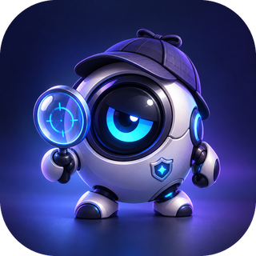
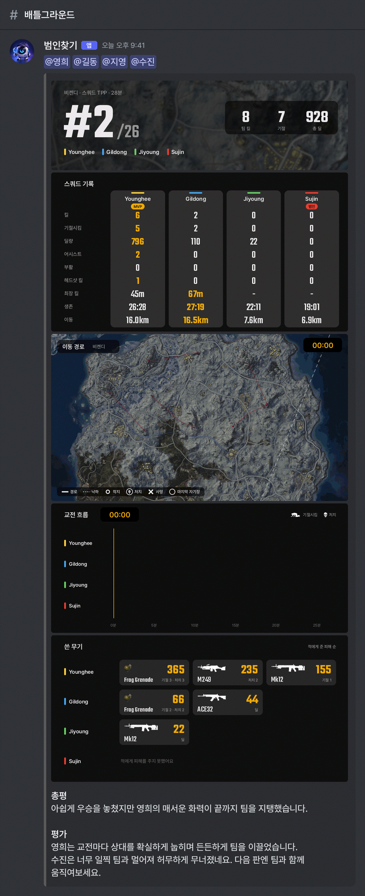
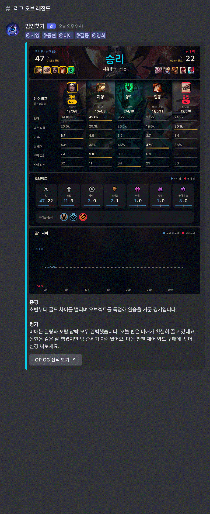
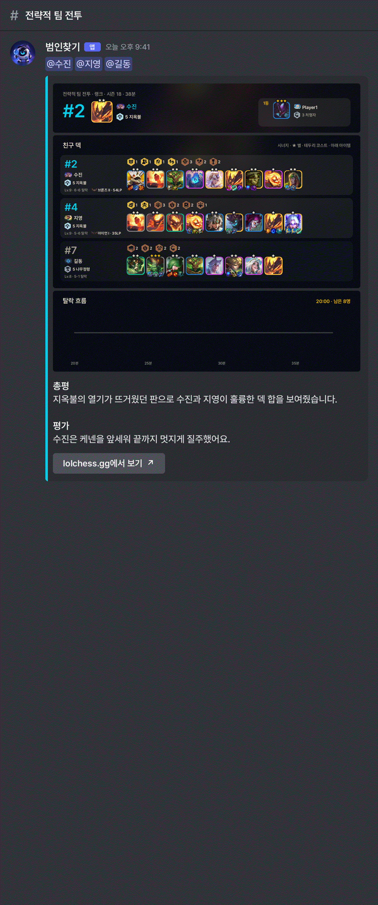
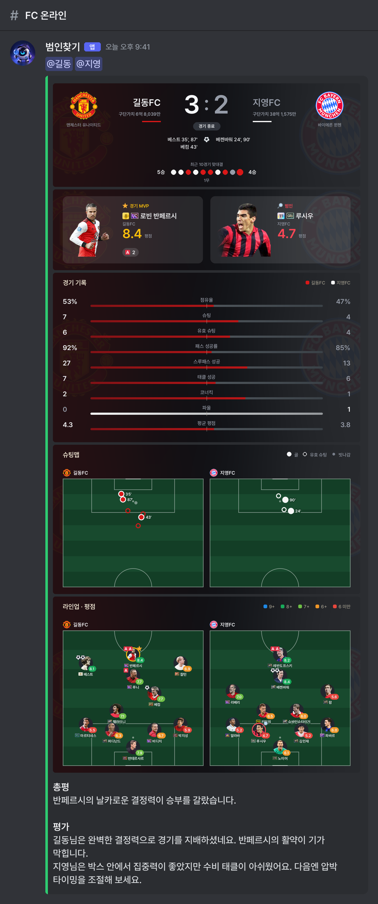

<h1 align="center">범인찾기 (imposter-finder)</h1>

친구들끼리 한 **배틀그라운드 · 리그 오브 레전드 · 전략적 팀 전투 · FC 온라인** 경기를 찾아, 끝나면 Discord에 경기 분석 이미지와 한 줄 판독을 올려 주는 봇입니다. 누가 캐리했고(MVP) 누가 발목을 잡았는지(범인) 기록으로 가려 줍니다.

- 15분마다 친구들의 최근 경기를 게임 API에서 가져와, 등록된 친구가 두 명 이상 함께한 경기만 골라냅니다.
- 게임마다 분석 화면처럼 결과·선수 기록·경기 흐름 카드를 만들고, 시간 흐름이 있는 카드(이동 경로·교전 흐름·골드 차이·탈락 흐름)는 GIF로 보여 줍니다.
- 맨 아래 **총평 · 평가**는 Gemini가 기록을 근거로 해설자 말투로 씁니다.
- GitHub Actions에서 돌며 서버가 필요 없습니다 ([cron-job.org](https://cron-job.org)가 15분마다 실행).

## 리포트 예시

> 디스코드에 실제로 올라오는 모습입니다 (누르면 크게). 실제 경기로 만들었고 이름과 닉네임만 가명으로 바꿨습니다 ([tools/readme_samples.py](tools/readme_samples.py)).

  
  

  
  

- **배그**: 결과·순위 · 스쿼드 기록(MVP·범인) · 이동 경로 GIF · 교전 흐름 GIF · 쓴 무기 / 팀 데스매치는 라운드 결과·양 팀 비교
- **롤**: 결과 · 선수 비교(MVP·ACE·범인) · 경기 흐름 GIF(미니맵·교전·오브젝트·골드 차이) · OP.GG 버튼 / 부계정도 사람 기준으로. 타임라인에 근거한 총평 · 친구 전원 평가 · 다음 판 개선 방향
- **TFT**: 요약(꼬마 전설·핵심 챔피언·덱 이름, 친구가 못 하면 그 판 1등) · 친구 덱(시너지·별·아이템·티어 LP) · 탈락 흐름 GIF · lolchess.gg 버튼 / 개인전이라 범인 없음
- **FC**: 스코어보드(엠블럼·구단 가치·맞대결 10경기) · MVP·범인 · 경기 기록(xG) · 슈팅 리플레이 GIF · 라인업

## 문서

| 문서 | 내용 |
|---|---|
| [docs/setup.md](docs/setup.md) | 설치, `.env`·`players.json`, GitHub Actions + cron-job.org 설정 |
| [docs/how-it-works.md](docs/how-it-works.md) | 게임별 수집·판정·리포트 동작 |
| [docs/flow.html](docs/flow.html) | 흐름도 |
| [docs/versions.md](docs/versions.md) | 버전별 변화 |
| [docs/fc-online.md](docs/fc-online.md) | FC 온라인 데이터 출처와 제약 |

Python 3.14 · Pillow · PUBG Developer API · Riot API · NEXON Open API · Gemini · Discord REST. 글꼴은 [Pretendard](https://github.com/orioncactus/pretendard)와 [Teko](https://github.com/googlefonts/teko) (OFL).

## 운영 모니터링

개인 Agents 서버에 기능 장애·오류 요약·복구 알림을 모읍니다. 실행 누락은 Healthchecks가 별도로 감지합니다. [모니터링 설정·운영 안내](docs/monitoring.md).

### 롤 경기 흐름 GIF 미리보기

`PYTHONPATH=. .venv/bin/python tools/lol_kill_gif.py`로 로컬 샘플을 렌더링합니다.
`data/lol-gif-preview/`의 `match.json`, `timeline.json`, `names.json`(PUUID → 친구 이름)을 사용합니다.
경로와 부활 시각은 관측 자료를 바탕으로 한 추정이며, 샘플 데이터·결과 파일은 Git에서 제외합니다.
자동 리포트와 동일한 렌더러를 사용합니다. 긴 경기는 재생 속도를 자동 조절하고, 실제 인코딩 결과도 8MiB 이하로 제한합니다.
타임라인이 없거나 지원하지 않는 맵이거나 생성에 실패하면 기존 오브젝트·골드 카드로 대체합니다.

### 3D 하이라이트의 관측과 재현

롤은 약 1분 간격 위치 관측과 사망 좌표를 사용합니다. 그 사이 이동, 공격자·어시스트 위치,
부활 시각과 기울인 지도 표현은 추정이며 실제 리플레이 좌표가 아닙니다.
FC는 슛·도움 좌표를 바탕으로 장면을 연출합니다. 선수 관절과 이동량 기반 보행을 3D로 그리지만
주변 선수의 이동과 공의 높이·골문 내 도착점은 API가 관측한 움직임이 아닙니다.
배그는 텔레메트리 위치를 보간하고 주변 지형 높이를 추정합니다. 카메라 소개 중 회전을 피하고
높이 과장을 없애 거리 관계를 읽기 쉽게 유지합니다.

하이라이트 실험 브랜치의 캐릭터 메시:
- 롤은 [Khada](https://modelviewer.lol/)의 기본 스킨 GLB를 로컬 캐시에 받아 실제 메시·리그의 대기/달리기 애니메이션을 방향별로 렌더링한다. 경기에서 사용한 스킨·스킬 동작·변신 상태를 재현하지 않는다. 모델 다운로드나 해석에 실패하면 기존 챔피언 초상으로 표시한다.
- FC 선수는 Quaternius의 CC0 Animated Men 메시를 사용한다. [GLB 변환본 출처](https://github.com/kendrekaran/striker-3d/tree/main/assets), 라이선스 원문은 `assets/models/LICENSE-quaternius.txt`. 메시를 팀별로 색칠하고, 보행은 리그 애니메이션, 킥은 뼈 회전으로 표현한다. EA 원본 모델이나 개별 선수의 얼굴·체형을 재현한 모델은 아니다. 미니페이스온과 득점/도움 기록은 실제 넥슨 데이터를 사용한다.
- 배그 지형의 세로 열 렌더링을 실제 기울어진 카메라의 시선으로 보정하며, 사람·탄도·가려짐에도 같은 카메라 공간 깊이를 사용한다.
